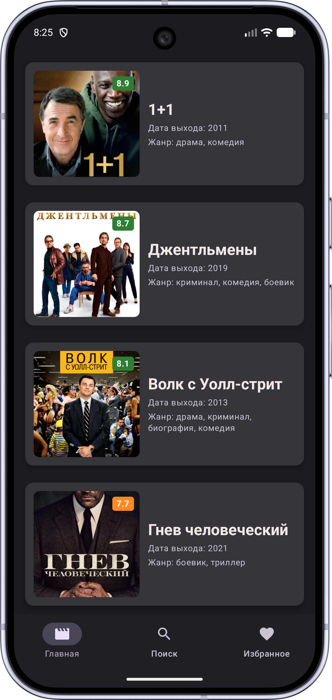
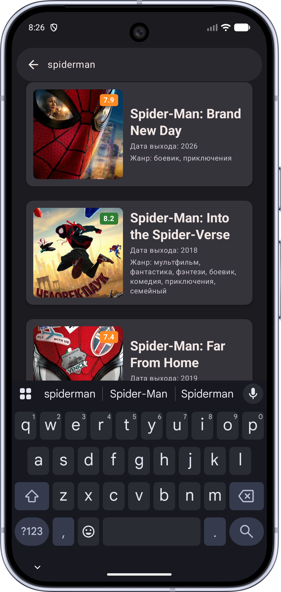
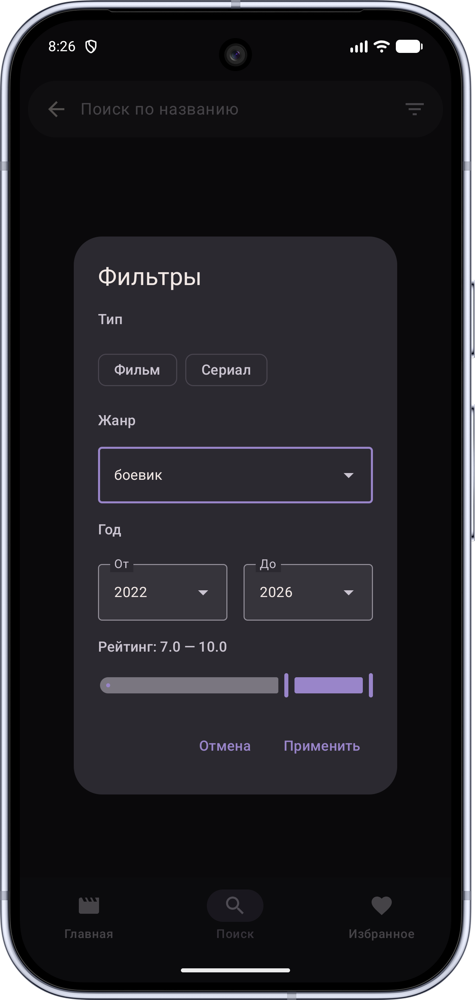

# MovieFlow

Приложение для поиска и просмотра фильмов: каталог, рейтинги, описания и
подборки. Доступно на Android.

  
  
  

## ✨ Возможности

- 🎞 Каталог фильмов с постерами, рейтингами и описаниями
- 📅 Экран с деталями фильма: постер, описание, рейтинг, актеры
- 🔍 Поиск по названию, фильтры по жанрам, году и рейтингу
- 💾 Сохранение избранного (в разработке)

## 🛠 Технологии

- **Kotlin** + **Jetpack Compose**
- Архитектура: **MVVM**
- **Coroutines / Flow** — асинхронность
- **Retrofit** — работа с API
- DI - **Hilt**

## 🚀 Установка

Скачайте APK из раздела Releases или соберите проект в Android Studio

## 📥 Скачать

[APK:]
