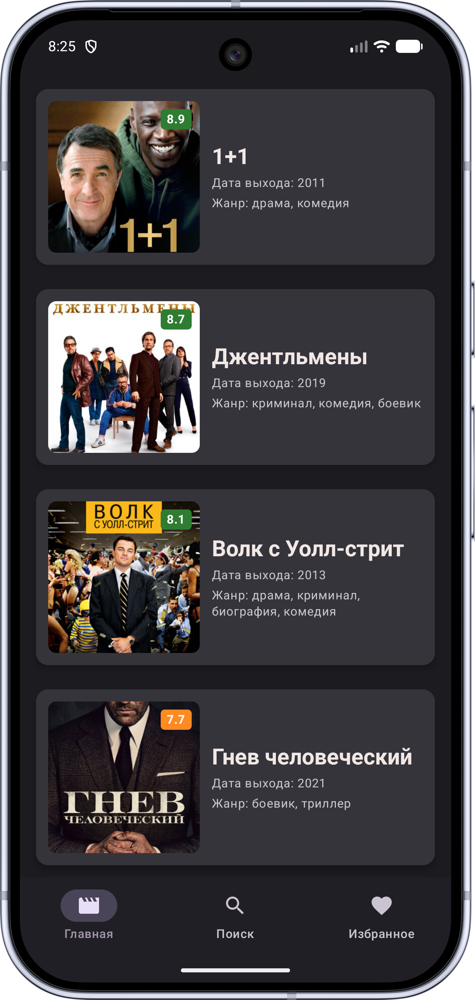
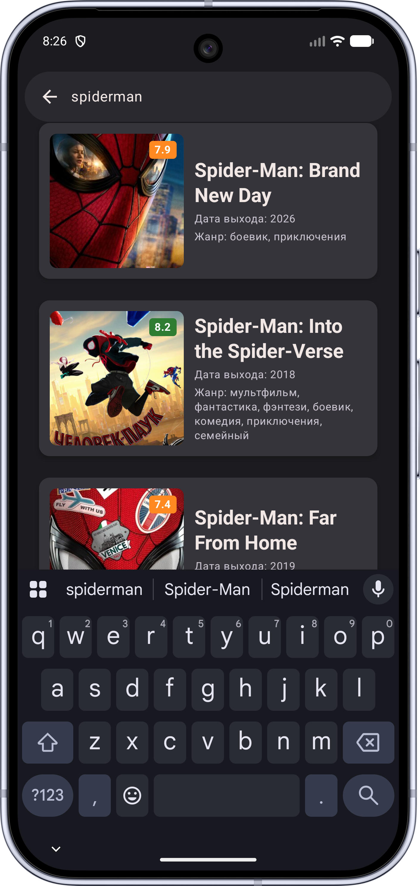
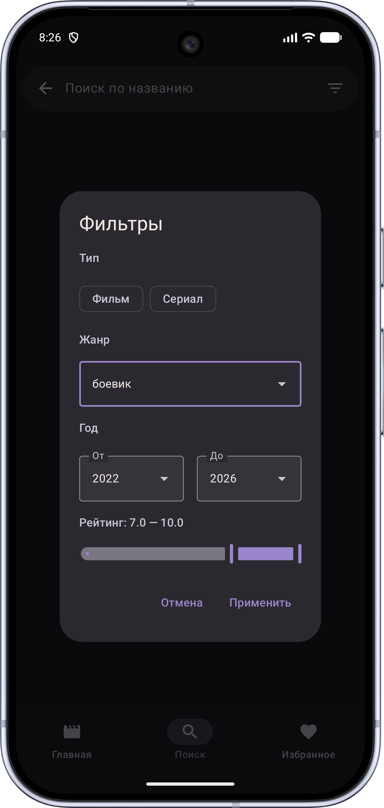

# MovieFlow

A mobile Android app for discovering movies and TV series: browse the catalog, check ratings and descriptions, and use search & filtering.

## ✨ Features

- 🎬 Movie catalog with posters, ratings, and detailed descriptions
- 📺 Detailed movie screen: poster, synopsis, rating, cast, and key info
- 🔍 Smart search by title plus filters by genre, release year, and rating
- ❤️ Favorites section

## 📱 Screenshots

| Catalog | Search | Filters|
|:---:|:---:|:---:|
|  |  |  |

## 🛠 Tech Stack

- **Kotlin** + **Jetpack Compose** for modern, reactive UI
- Architecture: **MVVM** (clean separation of concerns)
- Asynchronous operations via **Coroutines** and **Flow**
- Network layer with **Retrofit** for API integration
- Dependency injection using **Hilt**

## 📋 Requirements

- Android 9.0+ (API 28)

## 📥 Download

Grab the latest signed APK from the [Releases page](../../releases/latest).
